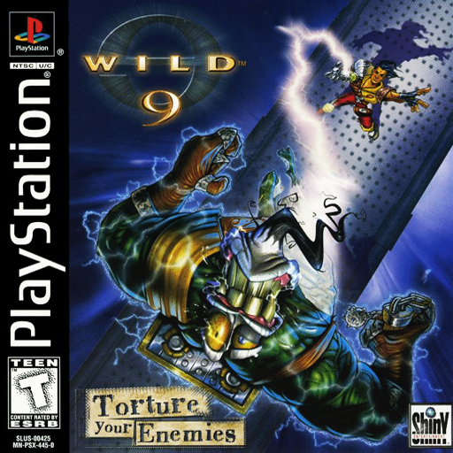

# Wild 9 Recompiled

Static recompilation and native PC port of Wild 9 (PlayStation 1, NTSC-U SLUS-00425).

[](https://github.com/plinkr/Wild9Recomp/releases)
[](https://github.com/plinkr/Wild9Recomp/releases/latest)
[](https://github.com/plinkr/Wild9Recomp/releases/latest)

<p align="center">
  
</p>

<div align="center">
  <p style="max-width:900px; margin:0 auto;">Screenshots (click a thumbnail to view full size):</p>
  <div style="margin-top:12px; overflow-x:auto; white-space:nowrap; padding:8px 4px; -webkit-overflow-scrolling:touch;">
    <a href="https://github.com/user-attachments/assets/7784e243-98aa-4e82-9107-4bdabb7146bc" target="_blank" rel="noopener">
      
    </a>
    <a href="https://github.com/user-attachments/assets/5e9e5a1a-76ab-438c-8e88-df57aa4a49e4" target="_blank" rel="noopener">
      
    </a>
  </div>
</div>


## Overview

Wild 9 is a 2.5D platform action game developed by Shiny Entertainment and published by Interplay in 1998 for the Sony PlayStation. This project is a native PC port of the original USA release (SLUS-00425). The MIPS R3000A code from the game executable is translated ahead of time into C and compiled into a regular PC program, so the game runs without an emulator.

The recompiled code runs on top of [psxrecomp](https://github.com/RetroPortingToolKit/psxrecomp) and the [recomp-ui](https://github.com/RetroPortingToolKit/recomp-ui) launcher, which handle graphics, audio, input, the BIOS, and mods. Game logic, physics, and timing are the original ones.

## Features

- Runs natively on 64-bit Linux, Windows, and macOS.
- No BIOS dump needed: the open-source PCSX-Redux OpenBIOS is included.
- Cleaner 3D: no texture warping or polygon jitter.
- Widescreen (16:9) gameplay.
- Smoother motion at 60, 120, 144, 165 FPS or your monitor's refresh rate, without changing game speed.
- Skip intro videos with a button press.
- Play in English, French, German, Italian, Spanish, or Japanese.
- Optional brightness boost for the game's darker areas.
- Rig Overhead Hover: hold both triggers to keep a grabbed object or enemy locked above Wex's head.
- Built-in cheats and a debug overlay, toggled from the launcher.

---

## How to Play

You need two things: a release build for your system and your own Wild 9 disc image. Nothing else has to be installed.

### 1. Download

Get the file for your system from the [Releases](https://github.com/plinkr/Wild9Recomp/releases/latest) page:

| System | File |
| --- | --- |
| Windows | `wild9-<version>-windows-x64.zip` |
| Linux | `wild9-<version>-x86_64.AppImage` (single file) or `wild9-<version>-linux-x64.zip` |
| macOS (Apple Silicon: M1 and newer) | `wild9-<version>-macos-arm64.zip` |
| macOS (Intel) | `wild9-<version>-macos-x64.zip` |

### 2. Start the launcher

- **Windows:** Extract the ZIP to a folder and run `Wild9_Recompiled.exe`.
- **Linux (AppImage):** Make the file executable and run it. Double-clicking also works on most desktops.

  ```bash
  chmod +x wild9-<version>-x86_64.AppImage
  ./wild9-<version>-x86_64.AppImage
  ```

- **Linux / macOS (ZIP):** Extract the ZIP and run `Wild9_Recompiled`.

### 3. Select your disc image

Click **Browse** and pick your Wild 9 (USA) disc image. Only the USA version works, the launcher checks the disc and rejects other versions.

Supported formats:

| File | Notes |
| --- | --- |
| `.cue` | Most common. Keep the `.cue` and its `.bin` file(s) in the same folder. |
| `.chd` | Compressed image, one single file. |
| `.bin` | Raw dump. If a matching `.cue` is next to it, that one is used. |

The disc is only read for game data (levels, music, cutscenes). It is never modified.

### 4. Play

Optionally open the **Mods** tab to turn on widescreen, higher frame rates, language, cheats, and so on (see [Mods](#mods) below). Then press **PLAY**.

### Where saves are stored

- **ZIP builds:** in the same folder as the executable. Keep that folder when updating.
- **AppImage:** in `~/.local/share/Wild9Recomp/`. Replacing the AppImage with a newer one keeps your saves and settings. Set `WILD9RECOMP_DATA_DIR` to use a different folder.

---

## Mods

All mods are set up from the **Mods** tab in the launcher before starting the game.

- **Widescreen:** Shows more of the level to the sides in 16:9.
- **Frame Rate:** Smoother motion at 60, 120, 144, 165 FPS or your display's refresh rate. The game itself still runs at its original speed. Requires the OpenGL renderer.
- **FMV Skip:** Skip intro videos with a button press. `Start` by default; can be changed to `Cross`, `Square`, `Triangle`, or `Select`.
- **Language:** English, French, German, Italian, Spanish, or Japanese. Japanese uses the script and font from Wildroid 9 (the Japanese release), already included in release builds, so you still only need the USA disc.
- **Enhanced Brightness:** Brightens dark areas and shadows. Default is `1.30`; set it to `1.00` for the original look. Requires the OpenGL renderer.
- **Rig Overhead Hover:** Carrying things with the Rig is one of the most awkward parts of the original game, for example taking the Nitro through the Gulag level. With this mod, hold both triggers (`R2` + `L2`, or `RT` + `LT` on Xbox-style pads) and whatever you are holding stays fixed above Wex while you run and jump. Release the triggers to get the normal Rig controls back, for example to slam an enemy. The hover height can be adjusted (2000 to 5000, default 2400).
- **CD Speed** and **Fast Loading:** Shorter loading times. Both are off by default; `4` is the recommended multiplier, and very high values can stall a load.
- **Debug Overlay:** Shows the game's built-in performance counters (CPU, GPU, memory, draw calls).
- **Developer Level Select:** Opens the developers' hidden level select instead of the main menu. Pick a level with `Start` or `Cross`, or choose **MAL MENU** to go to the normal menu. A few entries load nothing because their data isn't on the disc.
- **Collision Boxes:** Shows the hitboxes of Wex, enemies, bosses and projectiles, even through walls. It also shows the hidden warps in Wreckage and Drench. You choose which groups to show.
- **Gameplay Cheats:** See [Cheats](#cheats).

---

## Cheats

### In-Game Controller Codes

**Pause** the game, then enter one of these sequences:

| Effect | Buttons |
| --- | --- |
| Full health | `R1`, `Triangle`, `L1`, `Left`, `Triangle`, `Circle`, `Cross` |
| Unlock all levels | `Up`, `Left`, `Down`, `R2`, `Right`, `Square`, `Cross` |
| Red beam | `Right`, `Up`, `Left`, `Circle`, `Up`, `Circle`, `Circle` |
| 10 extra grenades | `R1`, `Cross`, `R1`, `Right`, `Square`, `Right`, `Square` |
| 10 extra missiles | `Cross`, `Circle`, `R1`, `Right`, `Triangle`, `Cross`, `Triangle` |
| Developer flight mode: hold `L2` to fly with the D-pad, invulnerable | `Left`, `Up`, `Left`, `Triangle`, `Down`, `Triangle`, `Circle` |
| Pokkit (Craterscape only) | `Cross`, `Right`, `Down`, `Triangle`, `Up`, `Cross`, `Triangle` |

### Built-in Cheats via Launcher (Mods)

> [!WARNING]
> These cheats change game memory directly and will cause glitches or let you skip parts of levels by accident.

Turn them on in the **Mods** tab (all are off by default):

- **Infinite Lives:** Your lives go back to 3 when you lose one.
- **Infinite Health:** Health refills after taking damage.
- **Infinite Missiles on Pick-Up:** Missiles stay at 3 once you collect them.
- **Moon Jump:** Hold Jump (`Cross`) to keep rising.
- **Infinite Rig Energy:** The Rig beam's energy bar stays full.
- **Infinite Health (Drench)** and **Moon Jump (Drench)**: Same as above, but for the Drench level, which needs its own version.

---

## Retro Launcher

This game can also be installed and updated through **[Retro Launcher](https://github.com/RetroPortingToolKit/Retro-Launcher)**, which manages several recompilation projects from one place.

---

## Building from Source

Players do not need this section, the release builds already contain everything. Building requires your own disc image to generate the recompiled C code. You need `CMake`, `Ninja`, a `C/C++ compiler`, and `Python 3`.

Clone the repository with its submodules:

```bash
git clone --recursive https://github.com/plinkr/Wild9Recomp.git
cd Wild9Recomp
git submodule update --init --recursive
```

### 1. Generate the game C code

There are two ways to do this. Both write the recompiled sources to `generated/`.

**Option A: Python CLI.** One command; it builds the recompiler tools if they are missing, then runs them:

```bash
python3 psxrecomp/psxrecomp_cli.py generate \
  --config game.toml \
  --project-root . \
  --disc "disc/Wild 9 (USA).cue"
```

**Option B: Run the recompiler directly.** Useful while developing, when you want to rebuild the recompiler yourself and rerun only the step you changed:

```bash
# Configure and build the recompiler tools
cmake -S psxrecomp/recompiler -B psxrecomp/recompiler/build -G Ninja -DCMAKE_BUILD_TYPE=Release
cmake --build psxrecomp/recompiler/build --target psxrecomp-game
cmake --build psxrecomp/recompiler/build --target psxrecomp-bios

# Recompile the game executable from the disc
psxrecomp/recompiler/build/psxrecomp-game --config game.toml --disc "disc/Wild 9 (USA).cue"
```

### 2. Generate the BIOS C code

The runtime also links a recompiled BIOS, and it has to exist before CMake is configured. Generate it with the bundled OpenBIOS profile:

```bash
cd psxrecomp && bash tools/regen_bios.sh --config bios/OpenBIOS.toml ; cd ..
```

Run this again after updating the `psxrecomp` submodule or rebuilding `psxrecomp-bios`, so the BIOS code matches the recompiler. Other profiles, such as `bios/SCPH1001.toml`, are in `psxrecomp/bios/`; those need your own Sony BIOS dump.

### 3. Build and run

```bash
cmake -S . -B build-release -G Ninja -DCMAKE_BUILD_TYPE=Release
cmake --build build-release --target psx-runtime
./build-release/Wild9_Recompiled
```

For a debug build with the runtime's debug tools (TCP debug server, heartbeat, per-block recording), use a separate build directory:

```bash
cmake -S . -B build-test -G Ninja -DCMAKE_BUILD_TYPE=RelWithDebInfo -DPSX_DEBUG_TOOLS=ON
cmake --build build-test --target psx-runtime
```

After changing `game.toml` or the recompiler, regenerate the game code (step 1) and rebuild (step 3).

### Packaging release builds

After generating the game sources, these scripts produce the same self-contained files published on the Releases page, written to `dist/`:

```bash
sh tools/package_appimage.sh        # -> dist/wild9-<v>-x86_64.AppImage
sh tools/package_product_zip.sh     # -> dist/wild9-<v>-<host>.zip
```

They need CMake, Ninja, a C/C++ compiler, Python 3, and ImageMagick (AppImage only). `tools/product_build_verify.sh` checks that the result really is a standalone release build.

### Generated sources for CI

CI builds use a pre-generated bundle of the recompiled C code instead of a disc image. Create it with:

```bash
python3 scripts/pack_generated_bundle.py --jp-disc "<your Wildroid 9 (Japan) .cue>"
```

`--jp-disc` also extracts the Japanese text and font from a Wildroid 9 disc into `generated/wild9_japanese_text.c`. That file is compiled in when present and must never be committed.

CI downloads the bundle using these repository secrets:

| Secret | Value |
| --- | --- |
| `PSXRECOMP_GENERATED_BUNDLE_URL` | Direct URL to `generated-bundle.tar.gz` |
| `PSXRECOMP_BUNDLE_TOKEN` | Read token for the bundle repository |

### Notes

Wild 9 has no overlay executables, all game code lives in `SLUS_004.25`, and level data is streamed from `W9.CDD` and `W9.IDX`. For that reason `packaging/release/game.toml` sets `overlay_cache = false`.

---

## Licenses & Credits

- **Repository Code:** Licensed under the **MIT License**. See [LICENSE](LICENSE).
- **Framework:** [PSXRecomp](https://github.com/RetroPortingToolKit/psxrecomp) is licensed under the **PolyForm Noncommercial 1.0.0 License**. Copyright (c) 2026 Matthew Stanley. Commercial licensing: [https://1379.tech](https://1379.tech).
- **Launcher:** [recomp-ui](https://github.com/RetroPortingToolKit/recomp-ui) is licensed under the **MIT License**. Copyright (c) 2026 Matthew Stanley.
- **BIOS:** [OpenBIOS](https://github.com/grumpycoders/pcsx-redux) from PCSX-Redux is licensed under the **MIT License**. Copyright (c) 2019 PCSX-Redux authors.

### Disclaimer

This is an unofficial fan project. Wild 9 is a trademark of Shiny Entertainment and Interplay. No copyrighted game files or Sony BIOS dumps are included or distributed.
